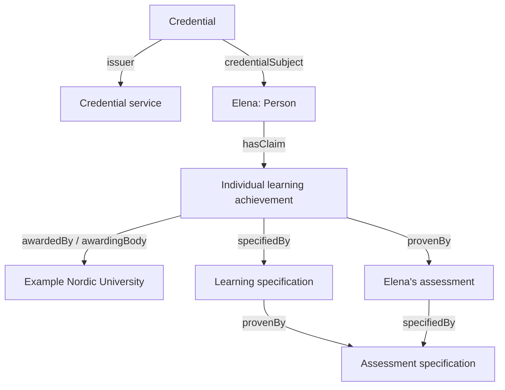

# Microcredential: from SHACL to JSON-LD to a W3C credential

## 1. Read the example as an ordinary statement

**Elena Kowalska completed “Introduction to Applied Data Ethics”, a 3-ECTS learning unit awarded by Example Nordic University. She received grade 4 on a five-point scale after assessment on 12 June 2026. Example Academic Credential Service issued the credential on 15 June 2026 on the university's behalf.**

Everything about the learner, organisations, award, assessment and accreditation is fictional. Names and identifiers under `example.org` are demonstration values. The credential is unsigned: it demonstrates a W3C VC 2.0 data structure, but it cannot establish that a real issuer made these claims.

The credential distinguishes three questions: **who is making the statement**, **what Elena achieved**, and **how the achievement was specified and assessed**. The service issuing the credential and the university awarding the learning achievement are intentionally different organisations.

## 2. Files and exercise path

| Step | File | What to do |
| --- | --- | --- |
| 1 | `microcredential-elm.shacl.ttl` | Inspect the original semantic profile, including its mandatory SD-JWT metadata projection. |
| 2 | `microcredential-context.jsonld` | Read the mapping from JSON keys to RDF terms and datatypes. |
| 3 | `microcredential-vc-example.jsonld` | Follow the learner, achievement, specification and assessment objects. |
| 4 | `microcredential-vc2.shacl.ttl` | Validate the expanded example with this W3C-specific derivative. |
| 5 | `validation-results.json` | Review the checks actually performed and their limits. |

The example starts with the official W3C context `https://www.w3.org/ns/credentials/v2`. Its second context is the **exact context object** from `microcredential-context.jsonld`, embedded inline. This makes the example usable without publishing a new context URL. To use a hosted context later, publish the standalone file at a stable versioned HTTPS URL and replace the inline object with that URL. No example.org context URL is presented as already hosted.

The standalone context is an **extension context**: combine it with the official W3C context rather than using it alone as a complete VC vocabulary.

## 3. How the credential is structured

`specifiedBy` points to reusable criteria: what a course or assessment means. `provenBy` connects the individual achievement to the assessment establishing it. Both routes identify the same assessment specification by its absolute IRI. The JSON repeats that identifier as a reference; RDF merges the references into one resource.

### Envelope and issuer

| JSON field | Example | Meaning |
| --- | --- | --- |
| `id` | `urn:uuid:02df6230-9947-4d73-9ebd-6c6b147d28cc` | Identifier of this credential document. |
| `type` | `VerifiableCredential`, `EuropeanDigitalCredential`, `MicrocredentialCredential` | W3C type, ELM type and a proposed profile-specific type. The last one is a draft example.org term. |
| `identifier.notation` | `DEMO-MC-2026-0007421` | Business identifier assigned to this microcredential instance; distinct from the document `id`. |
| `displayParameter.title` | `Introduction to Applied Data Ethics` | ELM display title; maps to `dct:title`. |
| `issuer.id` | `https://issuer.example.org/organisations/academic-credential-service` | Identifies the service making the credential statement. |
| `issuer.location.address.countryCode` | EU country IRI ending `/SWE` | Sweden, the issuing organisation's country. |
| `issuanceDate` | `2026-06-15T10:00:00Z` | An extension alias for ELM's reused `cred:issued`; this records issuance. |
| `validFrom` | `2026-06-15T10:00:00Z` | W3C VC 2.0 validity start. It happens to equal issuance in this example; the concepts are distinct. |
| `attestation_legal_category` | `non-qualified-EAA` | Carries the rulebook's declared category using the draft extension. The label alone does not confer legal status. |

`name` and `description` are W3C-context display metadata. They use schema.org terms and are intentionally separate from the ELM `title` and `learningOutcomeDescription` terms.

### Learner

Elena has a pseudonymous example subject IRI. `givenName` and `familyName` expand to FOAF properties; the class is `elm:Person`. The optional birth date, birthplace, citizenship, demonstration national identifier, address and email illustrate holder-matching data. Their inclusion here is for teaching; an actual issuance or presentation should include them only where justified. The national identifier `DEMO-PERSON-ID-0001` is not a real government identifier.

A mailbox is represented as `mailto:elena.kowalska@example.org`, an IRI, rather than an untyped email string. An address uses `Location → Address → Note`, preserving the ELM object structure.

### Achievement, workload and assessment

| JSON path relative to the achievement | Example | Meaning |
| --- | --- | --- |
| `awardedBy.awardingBody.legalName` | `Example Nordic University` | Organisation awarding the achievement. |
| `specifiedBy.learningOutcomes[]` | Identify ethical risks; propose proportionate safeguards | Structured statements of acquired outcomes, with a title and description for each. |
| `specifiedBy.creditPoint.point` | `"3.0"` | Three credit points. It is a numeric **string** because the input SHACL follows the current EDC CreditPoint convention. |
| `specifiedBy.creditPoint.framework.notation` | `ECTS` | Makes the credit system explicit; the number alone is insufficient. |
| `specifiedBy.level` | `http://data.europa.eu/snb/eqf/6` | The fictional example's EQF positioning. The specification also has type `elm:Qualification` because ELM assigns EQF/NQF properties to qualifications. |
| `specifiedBy.fieldOfEducation` | IRI ending `/isced-f/0613` | Field-of-education reference. |
| `specifiedBy.influencedBy[]` | Learning activity specification | Describes participation and activity type. |
| `provenBy[0].assessmentCompletionDate` | `2026-06-12T14:00:00Z` | Date/time of Elena's actual completed assessment; earlier than issuance. |
| `provenBy[0].grade` | `"4"` | Individual result, interpreted through the referenced grading scheme. |
| `specifiedBy.provenBy[0].gradingScheme` | Five-point scale; 3 or higher passes | Reusable criteria for interpreting the result. |
| `specifiedBy.stackable` | `true` | Draft extension indicating stacking intent. |
| `specifiedBy.partOfQualification` | `Example Certificate in Applied Data Science` | Identifies the fictional larger qualification. This example explicitly asserts a part-of relationship; stacking intent by itself would not prove one. |

The sample uses ECTS and therefore **omits `volumeOfLearning`**. The source rulebook's mandatory table lists both, but its conditional and integrity rules require exactly one. The SHACL applies that exclusive choice.

### Quality assurance

The root `qualityAssurance` value is `institutional-accreditation`. The awarding organisation has a fictional `elm:Accreditation` record with the same category code, an accrediting organisation, decision `approved`, decision date 15 January 2024 and review date 15 January 2029. Field, jurisdiction and EQF-scope examples are included.

A general QA category is a draft extension because it can exist without formal accreditation. The optional accreditation object should be created only when there really is an accreditation record. **This example's accreditation is fictitious and is not a statement about any real institution.**

The accreditation's review date concerns that record, not automatic expiry of Elena's achievement. No `validUntil` is set on this credential, and no lifetime validity claim is implied by its absence.

## 4. Complete mapping of the source attributes

`CS` below means `credentialSubject`; `A` means `CS.hasClaim[0]`; `S` means `A.specifiedBy`; `AS` means `S.provenBy[0]`; `X` means `A.provenBy[0]`; `AB` means `A.awardedBy.awardingBody`.

| Rulebook attribute | JSON-LD representation / RDF meaning | Example status |
| --- | --- | --- |
| `attestation_legal_category` | Root; draft `mc:attestation_legal_category` | Included |
| `identifier` | `identifier.notation`; `adms:identifier / skos:notation` | Included |
| `title` | `displayParameter.title`; `elm:displayParameter / dct:title` | Included |
| `givenName` | `CS.givenName`; `foaf:givenName` | Elena |
| `familyName` | `CS.familyName`; `foaf:familyName` | Kowalska |
| `issuerCountry` | `issuer.location.address.countryCode`; ELM country IRI | SWE |
| `awardingBody` | `AB`, typed `elm:Organisation`; `rov:legalName` | Included |
| `issuanceDate` | Root `issuanceDate`; `cred:issued` | Included |
| `learningOutcomes` | `S.learningOutcomes[]`; `elm:learningOutcome` | Two outcomes |
| `ECTS` | `S.creditPoint.point` with framework ECTS | `"3.0"` |
| `volumeOfLearning` | `S.volumeOfLearning`; `elm:volumeOfLearning`, `xsd:duration` | Omitted: exclusive alternative |
| `typeOfAssessment` | `AS.typeOfAssessment`; `dct:type` concept IRI | Included |
| `formOfParticipation` | `S.influencedBy[0].formOfParticipation`; `elm:mode` | Included |
| `qualityAssurance` | Root draft `mc:qualityAssurance` | Included |
| `dateOfBirth` | `CS.dateOfBirth`; `elm:dateOfBirth` | Included for demonstration |
| `placeOfBirth` | `CS.placeOfBirth.address.fullAddress.noteLiteral` | Included |
| `citizenshipCountry` | `CS.citizenshipCountry`; EU country IRI | POL |
| `nationalID` | `CS.nationalID.notation`; `elm:nationalId / skos:notation` | Dummy value |
| `registeredAddress` | `CS.location.address.fullAddress.noteLiteral` | Included |
| `mail` | `CS.contactPoint.mail`; `elm:emailAddress` | Example mailbox |
| `level` | `S.level`; `elm:EQFLevel` | EQF 6 |
| `nationalQualificationsFrameworkLevel` | `S.nationalQualificationsFrameworkLevel`; `elm:NQFLevel` concept | Supported; omitted rather than inventing official alignment |
| `educationLevelDescriptor` | `S.educationLevelDescriptor`; `elm:educationLevel` concept | intermediate |
| `learningOutcomeSummary` | `S.learningOutcomeSummary.noteLiteral` | Included |
| `fieldOfEducation` | `S.fieldOfEducation`; `elm:ISCEDFCode` | Included |
| `escoReference` | Outcome-level `escoReference[]`; `elm:relatedESCOSkill` IRIs | Supported; omitted rather than inventing skill alignment |
| `learningActivityType` | `S.influencedBy[0].learningActivityType`; `dct:type` concept | e-learning |
| `languageOfAssessment` | `AS.languageOfAssessment`; `dct:language` concept | `en` retained as notation |
| `idVerificationMethod` | `X.idVerificationMethod`; `elm:idVerification` | Included on actual assessment |
| `grade` | `X.grade`; `elm:grade` | `"4"` |
| `gradingScheme` | `AS.gradingScheme`; `elm:GradingScheme` | Included |
| `entryRequirements` | `S.entryRequirements[]`; `elm:entryRequirement` Notes | Included |
| `stackable` | `S.stackable`; draft `mc:stackable` boolean | true |
| `partOfQualification` | `S.partOfQualification`; `elm:isPartOf` qualification | Included |
| `accreditation` | `AB.accreditation`; `elm:Accreditation` | Fictional details included |
| `awardingBodyAddress` | `AB.location.address.fullAddress.noteLiteral` | Included |
| `awardingBodyHomepage` | `AB.homepage`; `foaf:homepage` IRI | example.org |
| `awardingBodyIdentifier` | `AB.identifier.notation`; `adms:identifier` | Dummy identifier |
| `additionalNote` | Root `additionalNote[].noteLiteral`; ELM Note | Included |

`awardingBody.legalIdentifier` is also represented, using `rov:registration` to an `elm:LegalIdentifier`. It is a nested component of `awardingBody`, not a fortieth top-level attribute.

## 5. What the context does, and what needs conversion

A JSON-LD context maps **terms**, not arbitrary nested paths. It cannot turn a flat `issuerCountry` into three nested objects, split a name, convert 80 hours to a duration, or infer who assessed whom. These transformations happen before JSON-LD processing. The example therefore uses the actual ELM graph structure.

| Source representation | Prepared JSON-LD value |
| --- | --- |
| ECTS number `3.0` | CreditPoint object, `point: "3.0"`, framework notation `ECTS` |
| Plain course title | `title`, whose context supplies the known language `en` |
| Date `1998-11-02` | `1998-11-02T00:00:00Z` under the inherited date-normalisation convention; this does not claim knowledge of the birth time |
| Country code `PL` | `http://publications.europa.eu/resource/authority/country/POL` |
| Plain address | `Location → Address → Note → noteLiteral` |
| Local classification token | SKOS Concept with `notation`, plus a stable concept IRI where one is governed |

English is a property-level default for textual fields, not a global default affecting identifiers or codes. For another language, use an explicit language value, for example `{"@value":"Soveltava dataetiikka","@language":"fi"}`. Do not relabel English text as Finnish during conversion.

The context leaves the W3C protected terms intact. `issuanceDate` here explicitly maps to `cred:issued`, an ELM-compatible extension to VC 2.0; `validFrom` is the standard VC 2.0 validity property. They are not interchangeable.

The earlier profile follows OWL-documentation string ranges for `elm:grade` and `elm:decision`. ELM's EDC application-profile documentation differs in places, so this exercise is not presented as full EDC application-profile conformance.

## 6. W3C envelope versus SD-JWT metadata

The current WE BUILD rulebook defines SD-JWT issuance and does not adopt this W3C representation. This exercise is a proposed alternate semantic encoding.

| Source metadata | Treatment in this W3C example |
| --- | --- |
| `iss` | Represents the same issuer identity as `issuer.id`. |
| `vct` | SD-JWT-specific; omitted. W3C type array identifies this proposed credential profile. |
| `iat` | SD-JWT NumericDate; omitted. Issuance is recorded by `issuanceDate`. |
| `cnf` | Omitted; no holder-binding key is fabricated. |
| `exp` | Omitted. For a W3C credential validity end, use `validUntil` if needed. |
| `nbf` | Omitted. W3C `validFrom` supplies validity start in this example. |
| `jti` | Omitted; W3C document `id` is provided. Do not assume the identifiers are automatically identical in every conversion. |
| `status` | Omitted; no real status service exists for this demonstration. |
| `trust_anchor` | Omitted; a fictional URL would not establish issuer trust. |
| `cryptographically_bound_to` | Omitted; no cryptographic co-binding is claimed. |

Optional context aliases beginning `sdJwt` retain a way to project transport fields to the original draft properties. In particular, these aliases avoid redefining W3C's protected `iat`, `nbf`, `exp` and `cnf` terms. They are not assertions that this JSON file is an SD-JWT.

The original SHACL therefore correctly reports missing `vct`, `iat` and `cnf`. The derivative disconnects only its mandatory transport node constraint and adds W3C type/validity checks; the learning constraints are retained. `validFrom` is mandatory in this teaching profile, a choice stricter than the general VC 2.0 data model.

## 7. Validation and hands-on changes

The delivered example passed JSON-LD 1.1 expansion, the derived SHACL (including SHACL-SPARQL and meta-validation), and an RDF graph round-trip through JSON-LD compaction. No populated JSON property is undefined in the combined contexts. The original-profile failure was checked to consist specifically of the three missing SD-JWT fields.

Try these changes on copies:

1. Change `creditPoint.point` to `"0"`: validation should fail.
2. Add `volumeOfLearning: "PT8H"` while retaining the CreditPoint: validation should fail because workload alternatives are exclusive.
3. Remove CreditPoint and use only `volumeOfLearning: "PT8H"`: the workload alternative should pass.
4. Move the assessment completion after issuance: chronology validation should fail.
5. Change accreditation type notation without changing `qualityAssurance`: validation should fail.
6. Keep `stackable: true` and remove the target qualification: the profile should report a warning, reflecting SHOULD rather than SHALL.

JSON-LD gives meaning to fields; SHACL checks data constraints; a securing mechanism and a verifier's trust policy establish whether an issuer's statement can be relied on. This package tests the first two. Live vocabulary membership, genuine accreditation, disclosure authorisation and cryptographic verification were not performed. Before operational issuance, replace draft namespaces, use governed taxonomy mappings, and have the authorised issuer apply an appropriate VC securing mechanism.

## 8. Sources

- [WE BUILD Microcredential rulebook](https://github.com/webuild-consortium/webuild-attestation-rulebooks-catalog/tree/main/rulebooks/rb-microcredential), v1.0, 20 October 2026; source blob `4b5a058373107f8401cac95940179474e6459bac`.
- [ELM ontology 3.3.1 documentation](https://europa.eu/europass/elm-browser/documentation/3-3-1/rdf/ontology/documentation/index-en.html).
- [W3C Verifiable Credentials Data Model v2.0](https://www.w3.org/TR/vc-data-model-2.0/).
- [Official W3C VC v2 context](https://www.w3.org/ns/credentials/v2).
