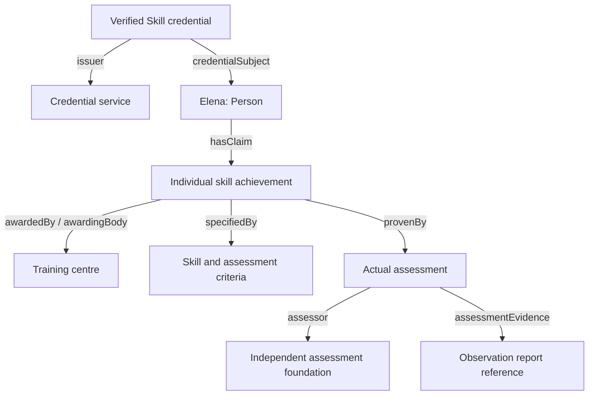

# Verified Skill: from rulebook to SHACL to JSON-LD to a W3C credential

## 1. Read the example as an ordinary statement

**Elena Kowalska demonstrated safe operation of an industrial hydrogen compressor under normal conditions. Example Hydrogen Training Centre awarded the skill claim. An independent example assessment foundation assessed her through structured observation, using a documented procedure. Her Dreyfus proficiency is “competent”, and the assurance level is “third-party-assessed”. The recorded estimated workload is 80 hours.**

The assessment was completed on 12 June 2026 and Example Skills Credential Service issued the credential on 15 June 2026. Review is recommended for 15 June 2029.

All people, organisations, skill results, standards/procedure references and evidence records are fictional demonstration data. The example is **unsigned**. It is not a real accreditation, certification, safety authorisation or licence to operate equipment. The practical example illustrates the contents of an attestation rather than providing operating instructions.

This exercise follows the same path as the accompanying microcredential exercise. Its important difference is the subject of the claim: **demonstrated skill**, rather than completion of a credit-bearing learning unit.

## 2. Files and exercise path

| Step | File | What to do |
| --- | --- | --- |
| 1 | `verified-skill-elm.shacl.ttl` | Inspect the 36 attestation attributes and 10 metadata fields from the current rulebook. |
| 2 | `verified-skill-context.jsonld` | Follow each JSON key to an ELM, reused standard or explicit draft extension term. |
| 3 | `verified-skill-vc-example.jsonld` | Read the tangible skill-assessment example. |
| 4 | `verified-skill-vc2.shacl.ttl` | Validate its RDF graph using the W3C-specific derivative. |
| 5 | `validation-results.json` | Inspect the actual validation and negative-test results. |

The example uses the official W3C VC 2.0 context first, followed by the exact inline object contained in the standalone extension context. A new context URL is not invented. To deploy a separate context, publish the file at a governed, versioned URL and replace the inline object with that URL.

The source rulebook is v0.2 dated 5 October 2026, as currently retrieved from GitHub. It supports SD-JWT VC and explicitly does not yet define W3C VCDM encoding. These files are therefore a **proposed W3C/ELM exercise profile**, not an adopted rulebook format.

## 3. How the credential is structured

The **skill achievement** carries Elena's demonstrated proficiency. The reusable **skill specification** describes what is being assessed, including skill outcomes and estimated effort. The actual **assessment** carries the result, assessor, assessment date and quality-assurance context. Proficiency is not put on the reusable course or skill definition, because another person could demonstrate a different proficiency against the same criteria.

The actual assessment's `specifiedBy.id` is the same absolute IRI as the assessment specification nested under the skill specification. RDF merges those references into one resource; no second assessment specification is implied by repeating the identifier.

### Envelope and issuer

| JSON field | Example | Meaning |
| --- | --- | --- |
| `id` | `urn:uuid:4ba902f5-7035-4d46-98bc-fd55d9a85592` | Credential-document identifier. |
| `type` | `VerifiableCredential`, `EuropeanDigitalCredential`, `VerifiedSkillCredential` | W3C type, ELM type, and proposed example.org profile type. |
| `identifier.notation` | `DEMO-VS-2026-0007421` | Attestation's business identifier. |
| `displayParameter.title` | `Industrial Hydrogen Compressor Operation` | Human-readable ELM display title. |
| `issuer.id` | Example credential service IRI | Organisation making the credential statement. |
| `issuer.location.address.countryCode` | EU country IRI ending `/NLD` | Netherlands; converted from the rulebook-style alpha-2 value `NL`. |
| `issuanceDate` | `2026-06-15T10:00:00Z` | Extension alias for `cred:issued`, retaining the ELM-compatible issuance statement. |
| `validFrom` | `2026-06-15T10:00:00Z` | W3C VC 2.0 validity start. |
| `attestation_legal_category` | `non-qualified-EAA` | Rulebook label, carried by a draft extension. It does not itself confer legal status. |

Elena's name and mailbox are included. Birth date, government identifier, citizenship, birthplace and address are supported by the context/profile but omitted from this example because the skill claim does not need them for the demonstration.

### Four dimensions that must remain separate

| Dimension | Example value | What it answers | What it does not establish |
| --- | --- | --- | --- |
| Demonstrated skill | Safe compressor operation under normal conditions | What can Elena demonstrably do? | It does not cover every emergency or every compressor model. |
| Dreyfus proficiency | `competent` | How does she perform the skill in context? | It is not EQF 6, a job grade, or a qualification level. |
| Assessment quality assurance | `third-party-assessed` | How was the assessment or its process independently assessed? | It does not mean Elena is an expert. |
| Estimated effort | `PT80H` | What meaningful learning/practice/assessment effort was associated with the skill? | It is not 80 ECTS credits or proof of actual hours worked. |

The five permitted Dreyfus strings are `novice`, `advanced-beginner`, `competent`, `proficient`, `expert`. The three assurance levels are `self-asserted`, `third-party-assessed`, `audited-assessment`. No numerical conversion is defined between these scales or between Dreyfus and EQF.

### Assessment and evidence

The actual assessment records `grade: "demonstrated"`. Its grading scheme defines three possible results: not yet demonstrated, demonstrated, and demonstrated with distinction. This gives a verifier a concrete interpretation of the result without turning the Dreyfus value into a grade.

`assessmentBasis` contains a Note describing three supervised demonstration shifts. `assessmentEvidence` contains an example report IRI, a short description and a responsible party. The named assessor makes the third party identifiable. Structural validation checks that identification is present; it cannot prove that the foundation is organisationally independent or that a report is genuine.

Evidence URLs under example.org are **identifiers for illustrative records**, not working report services. The package neither retrieves those reports nor claims that evidence was signed.

### Assurance method, framework and accreditation

The primary example uses an external assessment procedure and a named fictional assessment framework. It includes **no accreditation object** and makes **no ISO certification claim**.

A method that references an ISO standard describes a method; it does not prove certification. Where an actual accreditation exists, use the separate `elm:Accreditation` structure under a credential `evidence` node, matching the source rulebook's semantic reference. Where an audit supports `audited-assessment`, use structured audit information or explicitly identified equivalent audit evidence.

`reviewDate` belongs to the individual skill claim and concerns reassessment/review. It is a draft extension. `accreditationReviewDate`, if used inside an accreditation, maps to `elm:reviewDate` and concerns that accreditation. Neither automatically sets the credential's `validUntil`.

## 4. Complete mapping of the source attributes

`CS` means `credentialSubject`; `A` means `CS.hasClaim[0]`; `S` means `A.specifiedBy`; `X` means `A.provenBy[0]`; `AS` means `S.provenBy[0]`.

| Rulebook attribute | JSON-LD representation / RDF meaning | Example status |
| --- | --- | --- |
| `attestation_legal_category` | Root; draft `vs:attestation_legal_category` | non-qualified-EAA |
| `identifier` | `identifier.notation`; `adms:identifier / skos:notation` | Included |
| `title` | `displayParameter.title`; `elm:displayParameter / dct:title` | Included |
| `givenName` | `CS.givenName`; FOAF given name | Elena |
| `familyName` | `CS.familyName`; FOAF family name | Kowalska |
| `issuerCountry` | `issuer.location.address.countryCode`; ELM country IRI | NLD |
| `awardingBody` | `A.awardedBy.awardingBody.legalName`; ELM Organisation | Example Hydrogen Training Centre |
| `issuanceDate` | Root `issuanceDate`; `cred:issued` | Included |
| `skillOutcome` | `S.skillOutcome[]`; `elm:learningOutcome`, descriptions as `dct:description` | Included |
| `skillProficiencyLevel` | `A.skillProficiencyLevel`; draft extension, Dreyfus string | competent |
| `typeOfAssessment` | `AS.typeOfAssessment`; `dct:type` SKOS Concept | structured-observation |
| `qualityAssuranceMethod` | `X.qualityAssuranceMethod`; draft structured method | External documented procedure |
| `qualityAssuranceLevel` | `X.qualityAssuranceLevel`; draft controlled string | third-party-assessed |
| `dateOfBirth` | `CS.dateOfBirth`; `elm:dateOfBirth` | Supported; omitted |
| `placeOfBirth` | `CS.placeOfBirth.address.fullAddress.noteLiteral` | Supported; omitted |
| `citizenshipCountry` | `CS.citizenshipCountry`; EU country IRI | Supported; omitted |
| `nationalID` | `CS.nationalID.notation`; `elm:nationalId` | Supported; omitted |
| `registeredAddress` | `CS.location.address.fullAddress.noteLiteral` | Supported; omitted |
| `mail` | `CS.contactPoint.mail`; `elm:emailAddress` mailbox IRI | Included |
| `escoReference` | `S.skillOutcome[n].escoReference[]`; `elm:relatedESCOSkill` IRIs | Supported; omitted rather than fabricating an exact skill match |
| `studyLoadHours` | Preconvert numeric hours to `S.volumeOfLearning`; `elm:volumeOfLearning`, `xsd:duration` | `80` becomes `PT80H` |
| `assessmentBasis` | `X.assessmentBasis.noteLiteral`; `elm:additionalNote / elm:noteLiteral` | Included |
| `assessmentEvidence` | `X.assessmentEvidence[]`; explicit draft evidence links | Included |
| `formOfParticipation` | `S.influencedBy[0].formOfParticipation`; `elm:mode` concept | workplace-based |
| `learningActivityType` | `S.influencedBy[0].learningActivityType`; `dct:type` concept | work-experience |
| `languageOfAssessment` | `AS.languageOfAssessment`; `dct:language` concept | English, notation en |
| `idVerificationMethod` | `X.idVerificationMethod`; `elm:idVerification` | Included on actual assessment |
| `assessor` | `X.assessor`; `elm:assessedBy` Organisation/Person/Agent | Named foundation |
| `assessmentDate` | `X.assessmentDate`; `dct:issued` | 12 June 2026 |
| `grade` | `X.grade`; `elm:grade`, string | demonstrated |
| `gradingScheme` | `AS.gradingScheme`; `elm:GradingScheme` | Three-result scale |
| `qualityFramework` | `X.qualityFramework`; explicit draft structure | Included |
| `accreditation` | Root `evidence[].accreditation`; `cred:evidence / elm:accreditation` | Supported; omitted because no actual accreditation is claimed |
| `auditInformation` | `X.auditInformation`; draft structure | Supported; omitted for primary third-party example |
| `reviewDate` | `A.reviewDate`; draft reassessment date | 15 June 2029 |
| `additionalNote` | Root `additionalNote[].noteLiteral` | Demonstration notice |

There are no ECTS or EQF values in the Verified Skill example. A skill can be acquired through work experience without a formal course. Both workload and learning activity may be omitted when not meaningful, while the assessed skill, Dreyfus proficiency and assurance context remain required.

## 5. What the context does, and what needs conversion

The context uses the same ELM namespace and shared aliases as the microcredential exercise where meanings match. It uses `vs:` extensions for concepts that ELM does not directly express correctly: proficiency, assurance method/level/framework, specific assessment-evidence structures, audit details and a skill-review date.

| Conversion | Why it is needed |
| --- | --- |
| `awardingBody: "Example Hydrogen Training Centre"` → Organisation under AwardingProcess | A context cannot turn a string into the full ELM relationship structure. |
| Skill-outcome string → LearningOutcome object with a description | Preserves ELM classes and makes later ESCO alignment possible per outcome. |
| `studyLoadHours: 80` → `volumeOfLearning: "PT80H"` | ELM uses an XML Schema duration, not a numeric count of hours. |
| `NL` → EU country IRI ending `/NLD` | Country codes are identifiers, not translated preferred labels. |
| `structured-observation` → SKOS Concept with the same notation | Classification properties point to resources rather than untyped tokens. |
| Date-only value → dateTime under the documented midnight-UTC convention | Matches inherited ELM datatypes without pretending the actual clock time is known. |

The context **cannot perform these conversions by itself**. A preprocessing adapter must create the nested objects and converted values first. A numeric `80` cannot be given `elm:volumeOfLearning` directly through a context and thereby become a valid duration.

For fractional hours, convert to a valid day/time duration: 1.5 hours becomes `PT1H30M`. A processor may normalise `PT80H` to `P3DT8H`; these mean the same duration, 80 hours. The profile accepts equivalent day/time forms, excludes year/month durations and requires a positive value. Duration days mean 24 hours, not an eight-hour work shift.

English is the known language default on textual properties only. Use explicit JSON-LD language values for other languages; codes, identifiers, grades and procedure references remain typed strings. W3C protected terms remain unchanged.

### Proposed inner object fields

The rulebook intentionally leaves several objects open. This exercise makes the following **profile design choices**, rather than attributing these exact nested fields to the source:

| Object | Minimal structure in this exercise |
| --- | --- |
| `qualityAssuranceMethod` | Type `QualityAssuranceMethod`, nonempty `methodType`, plus `title` or `reference`. |
| `qualityFramework` | `title` or a nonempty `reference`. |
| `assessor` / `responsibleParty` / `auditor` | A typed ELM Organisation with legal name, or Person/Agent with `agentName`. |
| `assessmentEvidence` | Type `AssessmentEvidence` or `AuditEvidence`, and `evidenceReference`; optional description and responsible party. |
| `auditInformation` | Type `AuditInformation`, identified `auditor`, `evidenceReference`, `auditBasis`; optional `auditDate`. |
| Equivalent audit evidence | Type `AuditEvidence`, evidence reference, audit basis and a responsible party. |
| Actual `accreditation` | ELM Accreditation with title, type and named accrediting agent; decision/dates optional. |

An arbitrary observation report does not automatically satisfy the audited-assessment requirement. An accreditation's truth and relevance to the process still need external checks, even if its RDF structure passes SHACL.

## 6. W3C envelope versus SD-JWT metadata

| Source metadata | Treatment in this W3C example |
| --- | --- |
| `iss` | Same issuer identity expressed as `issuer.id`. |
| `vct` | `VerifiableVerifiedSkill` belongs to SD-JWT; omitted here. The proposed W3C type is `VerifiedSkillCredential`. |
| `iat` | Omitted; the example uses `issuanceDate` for the issuance statement. |
| `cnf` | Omitted; no holder-binding key is fabricated. |
| `exp` | Omitted; use W3C `validUntil` if a credential validity end is required. |
| `nbf` | Omitted; W3C validity starts at `validFrom`. |
| `jti` | Omitted; W3C `id` is present. |
| `status` | Omitted; there is no real status service in the demonstration. |
| `trust_anchor` | Omitted; no real issuer trust framework is claimed. |
| `cryptographically_bound_to` | Omitted; no cryptographic co-binding is claimed. |

Optional `sdJwt...` aliases in the context retain explicit transport projection mappings without redefining the official context's protected JWT terms. Their presence does not make this an SD-JWT.

The original profile requires `vct`, `iat` and `cnf`. The W3C example correctly fails those three original requirements. The derived profile disconnects that transport constraint and adds W3C type and validity checks; the skill, assurance and evidence constraints stay in force. Requiring `validFrom` is an explicit application-profile choice, not a claim that the general VC 2.0 specification requires it.

## 7. Validation and hands-on changes

The primary example passes JSON-LD expansion, derived SHACL validation including meta-validation, and an RDF round-trip through JSON-LD compaction. Populated JSON keys have context definitions, and ELM terms in the SHACL were checked against the published ontology documentation.

Try these changes on copies:

1. Change `skillProficiencyLevel` to `EQF-6`: validation fails, because qualification level is not Dreyfus proficiency.
2. Set `qualityAssuranceLevel` to `expert`: validation fails, because mastery and process assurance are different scales.
3. Remove the named assessor and the evidence's responsible party while keeping `third-party-assessed`: validation fails.
4. Change assurance to `audited-assessment` without adding audit support: validation fails. An observation-only evidence object is insufficient.
5. Add `auditInformation` identifying a named auditor, an audit-basis reference and a report IRI: the structural audit requirement can pass. This does not prove an actual audit occurred.
6. Remove `volumeOfLearning`: validation can still pass, because meaningful workload is optional for a work-experience skill.
7. Use `PT0H` or an unconverted numeric `80` for `volumeOfLearning`: validation fails.
8. Move `assessmentDate` after `issuanceDate`: validation fails.
9. Remove assessmentEvidence while retaining an identified assessor: the profile reports an advisory warning, reflecting the source's confidentiality-qualified SHOULD.

The rulebook's data integrity rules cannot be reduced entirely to SHACL. Structural checks cannot establish genuine organisational independence, actual accreditation, the truth of a skill judgement, or whether confidentiality prevents disclosure. They also cannot infer whether a grade should exist or whether birth-date disclosure is justified. Reference-dataset membership and cryptographic verification require separate processing.

### How this differs from the microcredential exercise

| Topic | Microcredential | Verified Skill |
| --- | --- | --- |
| Main claim | Completed learning unit | Demonstrated skill |
| Proficiency | Not introduced as a Dreyfus claim | Required Dreyfus stage on individual achievement |
| Workload | ECTS XOR learning duration | Optional positive hours expressed as duration; no ECTS |
| Formal qualification level | Optional EQF/NQF positioning | Not used as a proxy for proficiency |
| Assurance | General QA category, optional actual accreditation | Required method and assurance level; conditional audit/third-party support |
| Primary example | Grade 4 for a data-ethics course | Competent compressor-operation skill, independently assessed |
| Format status | Proposed W3C alternate encoding | Proposed W3C alternate encoding |

## 8. Sources

- [WE BUILD Verified Skill rulebook](https://github.com/webuild-consortium/webuild-attestation-rulebooks-catalog/tree/main/rulebooks/rb-verified-skill), v0.2, 5 October 2026; source blob `6c6883cf8510fdc31e80f7d32e58be4a58faed30`; retrieved 27 October 2026.
- [ELM ontology 3.3.1 documentation](https://europa.eu/europass/elm-browser/documentation/3-3-1/rdf/ontology/documentation/index-en.html).
- [W3C Verifiable Credentials Data Model v2.0](https://www.w3.org/TR/vc-data-model-2.0/).
- [Official W3C VC v2 context](https://www.w3.org/ns/credentials/v2).
